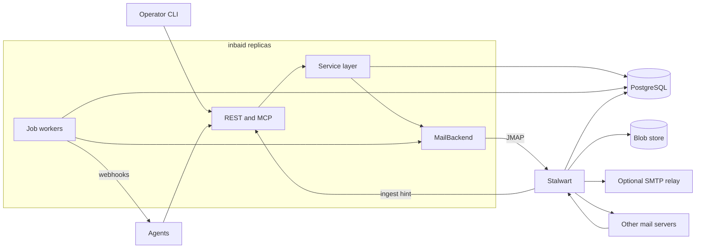

Status: current

# Architecture

inbAI is a control plane in front of a mail server. It provisions domains and inboxes, holds agent identity and grants, enforces quotas, and delivers events. It does not implement SMTP, IMAP, or spam filtering.

`inbai init` creates the Stalwart domain, operator, and service account described below. Inbox and message commands call `inbaid`, and `inbaid` calls the service layer, which calls Stalwart over JMAP. Grants are checked in that layer. They are not stored in PostgreSQL yet. An operator may use `INBAI_OPERATOR_TOKEN`. An agent uses an OAuth client credential, and the access token only names that agent. MCP is served at `/mcp` and by `inbai mcp serve`. The rest of this document is the design the remaining code will follow.

## Components

- `inbai` is the operator CLI. `init`, `domain add`, and `doctor` talk to Stalwart. Inbox and message commands call the REST API on `inbaid`.
- `inbaid` is the server. REST and MCP are transports over one service layer.
- The service layer is the only place that checks grants.
- PostgreSQL holds inbAI state and the job queue. Stalwart holds messages.
- Stalwart Community Edition runs as its own process. inbAI reaches it only over JMAP. No Stalwart source is vendored or linked, and no Enterprise feature is required.

## Identity and isolation

Operators and agents use the same mechanism: OAuth 2.1 client credentials issued by `inbaid`. A credential is a client ID and a secret. The secret is stored hashed and shown once. The access token is short-lived, signed, and names this server as its audience. Any replica can verify it from the signature. The token identifies the caller. Grants are read from PostgreSQL on every request, so a revocation takes effect immediately.

The inbox is the isolation boundary. A grant is a tuple of agent, inbox, and permissions. The permissions are `read`, `send`, `reply`, `delete`, and `manage`. One agent may hold many inboxes. One inbox may be granted to many agents. Only an operator can create domains and inboxes, unless an agent is granted `inbox:provision`.

Human sign-in through an external OIDC provider is not part of this design yet.

## Mail

Each inbox is one account in the mail server. The service layer talks to a `MailBackend` interface. Stalwart is the implementation that provisions accounts. A second implementation reads an existing mailbox over IMAP and submits mail over SMTP. It does not create accounts. `inbaid` uses it when `INBAI_MAIL=imap`.

Domain setup prints the zone file Stalwart computes, including MX, SPF, DKIM, and DMARC. `inbai domain add` does that and checks the MX and TXT records. `inbai doctor` also checks reverse DNS, port 25, TLS on port 443, and the Spamhaus ZEN and SpamCop blocklists. Direct delivery is supported, and an authenticated SMTP relay is a first-class setting. Sending has quotas per inbox, per domain, and per workspace, a rate limit per recipient domain, a suppression list fed by hard bounces, and a way to suspend an agent.

The API preserves `Message-ID`, `In-Reply-To`, and `References`. Inbound mail is untrusted input. Results will include SPF, DKIM, DMARC, and the spam verdict. MCP results mark message bodies as external content.

## Events and jobs

`GET /v1/events` long-polls an ordered, at-least-once feed for one inbox. `POST /v1/webhooks` registers a consumer. Deliveries are signed with `X-Inbai-Signature` and retried with backoff. The record is a JMAP state cursor in PostgreSQL, opened with `INBAI_DATABASE_URL`. `POST /v1/hooks/ingest` accepts a Stalwart `message-ingest` hint and matches the recipient address. A `delivery.dsn-perm-fail` event suppresses that recipient, and a later send is rejected before quota is consumed. Temporary delivery failures are not recorded. Stopping `inbaid` does not drop events, suppressions, grants, quota counters, idempotency keys, jobs, or client credentials that have been written. Without the database URL the event routes answer 503, and grants, quotas, idempotency keys, jobs, and credentials stay in that process. `/healthz`, `/readyz`, and `/metrics` are served on the same listener.

Message retention defaults to 30 days. An operator can change or disable it per server or per inbox.

## API

`api/openapi.yaml` is the contract. `inbaid serve` listens on `127.0.0.1:8787` and serves inbox create, list, delete, and bulk generate, and message list, search, read, send, reply, delete, and attachment download. Send and reply accept attachments. A generate of more than 50 addresses returns a job. When `INBAI_DATABASE_URL` is set, that job is in PostgreSQL. Without it the job stays in the server process. The caller presents `INBAI_OPERATOR_TOKEN` as a bearer token. Create and send accept an `Idempotency-Key`. A completed key returns the first result and does not send again. The default send quota is 50 messages per inbox per day and 500 per domain per day. Errors use RFC 9457 problem details. When `INBAI_DATABASE_URL` is set, quota counters and idempotency keys are in PostgreSQL. Without it they stay in the server process. List responses page with `limit` and an opaque `cursor`, and include `next` when another page remains. Client credentials are in that same database when the URL is set. A signing key set with `INBAI_SIGNING_KEY` is shared by replicas; otherwise the process prints a key once.

MCP tools are defined once and served two ways: Streamable HTTP at `/mcp` on `inbaid`, and stdio from `inbai mcp serve`. The HTTP transport has no protocol-level session, so it works behind a load balancer.

## Scaling rules

- `inbaid` keeps no state on disk or in memory between requests.
- Coordination goes through PostgreSQL.
- Stalwart is reached only through `MailBackend`.
- Nothing in inbAI depends on a Stalwart Enterprise feature.

The supported deployment is one Linux host running `inbaid`, PostgreSQL, and Stalwart. More `inbaid` replicas can sit behind a load balancer without a code change. Several Stalwart nodes can share PostgreSQL and object storage later. That clustered layout is not part of the first release.

Only port 25 and port 443 are public. Stalwart's own client and admin listeners stay on the internal network.

## Validated with Stalwart

A spike against Stalwart 1.1.1 accepted three choices. The records are [0008](adr/0008-stalwart-postgresql-store.md), [0009](adr/0009-impersonating-service-account.md), and [0010](adr/0010-event-cursors.md).

- Stalwart stores its own data in PostgreSQL, in a separate database. The spike left message blobs in that same database.
- `inbaid` uses one Stalwart service account with `impersonate`. Inbox accounts need `emailReceive`, and the service account must hold every permission it grants.
- A `message-ingest` webhook is a hint. It names the recipient address in `to`. The numeric `accountId` in the payload is not the JMAP account id. The durable record is a per-inbox JMAP cursor.
