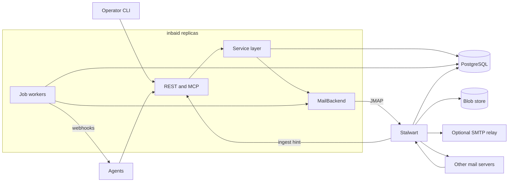

Status: current

# Architecture

inbAI is a control plane in front of a mail server. It provisions domains and inboxes, holds agent identity and grants, enforces quotas, and delivers events. It does not implement SMTP, IMAP, or spam filtering.

`inbai init` creates the Stalwart domain, operator, and service account described below. `inbaid` still only prints its version. The API, grants, and mail commands are not implemented. This document is the design the rest of the code will follow.

## Components

- `inbai` is the operator CLI. It is a client of the REST API.
- `inbaid` is the server. REST and MCP are transports over one service layer.
- The service layer is the only place that checks grants.
- PostgreSQL holds inbAI state and the job queue. Stalwart holds messages.
- Stalwart Community Edition runs as its own process. inbAI reaches it only over JMAP. No Stalwart source is vendored or linked, and no Enterprise feature is required.

## Identity and isolation

Operators and agents use the same mechanism: OAuth 2.1 client credentials issued by `inbaid`. A credential is a client ID and a secret. The secret is stored hashed and shown once. The access token is short-lived, signed, and names this server as its audience. Any replica can verify it from the signature. The token identifies the caller. Grants are read from PostgreSQL on every request, so a revocation takes effect immediately.

The inbox is the isolation boundary. A grant is a tuple of agent, inbox, and permissions. The permissions are `read`, `send`, `reply`, `delete`, and `manage`. One agent may hold many inboxes. One inbox may be granted to many agents. Only an operator can create domains and inboxes, unless an agent is granted `inbox:provision`.

Human sign-in through an external OIDC provider is not part of this design yet.

## Mail

Each inbox is one account in the mail server. The service layer talks to a `MailBackend` interface. Stalwart is the first implementation. Another provider would be a new implementation of that interface.

Domain setup prints MX, SPF, DKIM, and DMARC records. Direct delivery is supported, and an authenticated SMTP relay is a first-class setting. Sending has quotas per inbox, per domain, and per workspace, a rate limit per recipient domain, a suppression list fed by hard bounces, and a way to suspend an agent.

The API preserves `Message-ID`, `In-Reply-To`, and `References`. Inbound mail is untrusted input. Results will include SPF, DKIM, DMARC, and the spam verdict, and MCP results will mark message bodies as external content.

## Events and jobs

Delivery to consumers is at least once and ordered per inbox. Consumers can receive a signed webhook or long-poll `GET /v1/events`, because many agents cannot accept inbound connections. Background work runs from a PostgreSQL queue, so any replica can run workers. There is no Redis and no separate message broker.

Message retention defaults to 30 days. An operator can change or disable it per server or per inbox.

## API

`api/openapi.yaml` is the contract. Routes live under `/v1`. Lists use cursor pagination. Create and send requests accept an `Idempotency-Key`. Errors use one JSON problem shape. The file in the repository is a skeleton, and the server does not serve the API yet.

MCP tools are defined once and served two ways: Streamable HTTP at `/mcp` on `inbaid`, and stdio from `inbai mcp serve`. The HTTP transport has no protocol-level session, so it works behind a load balancer.

## Scaling rules

- `inbaid` keeps no state on disk or in memory between requests.
- Coordination goes through PostgreSQL.
- Stalwart is reached only through `MailBackend`.
- Nothing in inbAI depends on a Stalwart Enterprise feature.

The supported deployment is one Linux host running `inbaid`, PostgreSQL, and Stalwart. More `inbaid` replicas can sit behind a load balancer without a code change. Several Stalwart nodes can share PostgreSQL and object storage later. That clustered layout is not part of the first release.

Only port 25 and port 443 are public. Stalwart's own client and admin listeners stay on the internal network.

## Validated with Stalwart

A spike against Stalwart 1.1.1 accepted three choices. The records are [0008](adr/0008-stalwart-postgresql-store.md), [0009](adr/0009-impersonating-service-account.md), and [0010](adr/0010-event-cursors.md).

- Stalwart stores its own data in PostgreSQL, in a separate database. The spike left message blobs in that same database.
- `inbaid` uses one Stalwart service account with `impersonate`. Inbox accounts need `emailReceive`, and the service account must hold every permission it grants.
- A `message-ingest` webhook is a hint. It names the recipient address in `to`. The numeric `accountId` in the payload is not the JMAP account id. The durable record is a per-inbox JMAP cursor.
